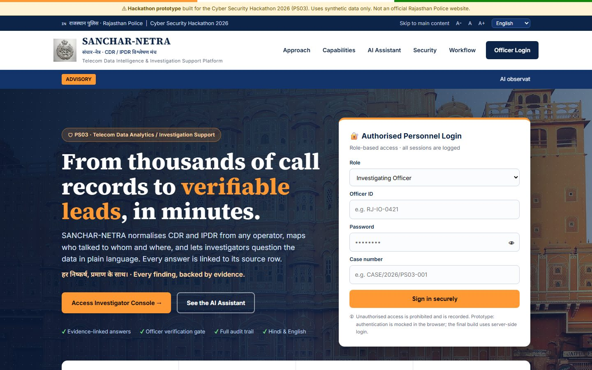
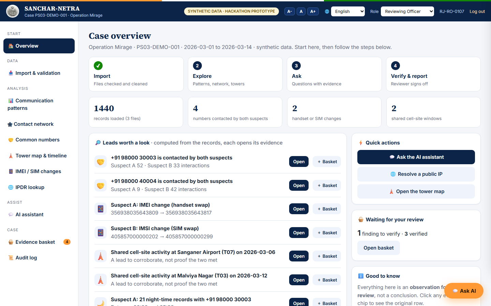
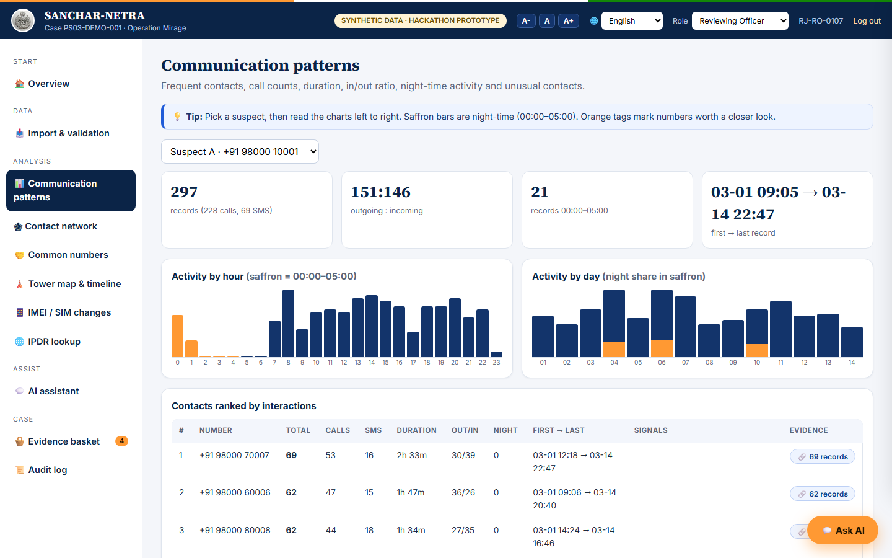
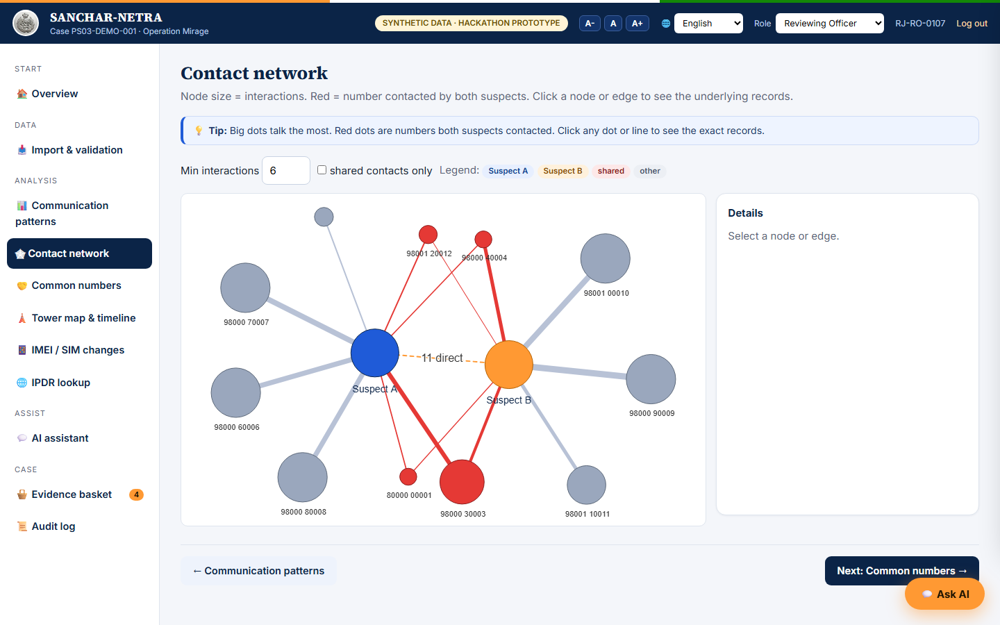
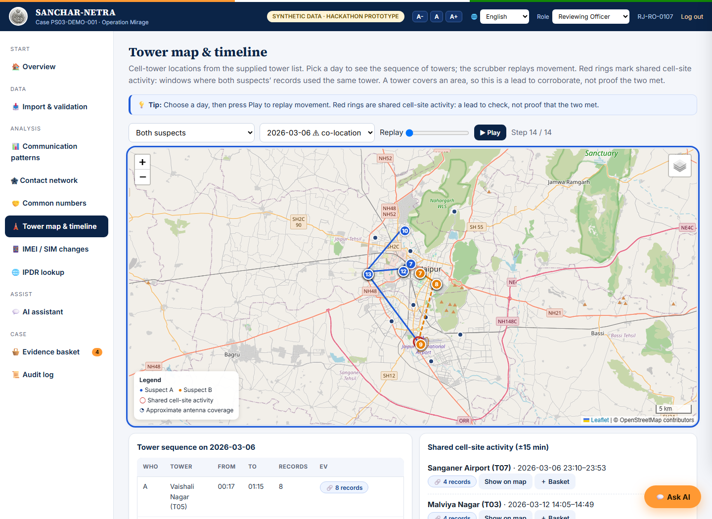
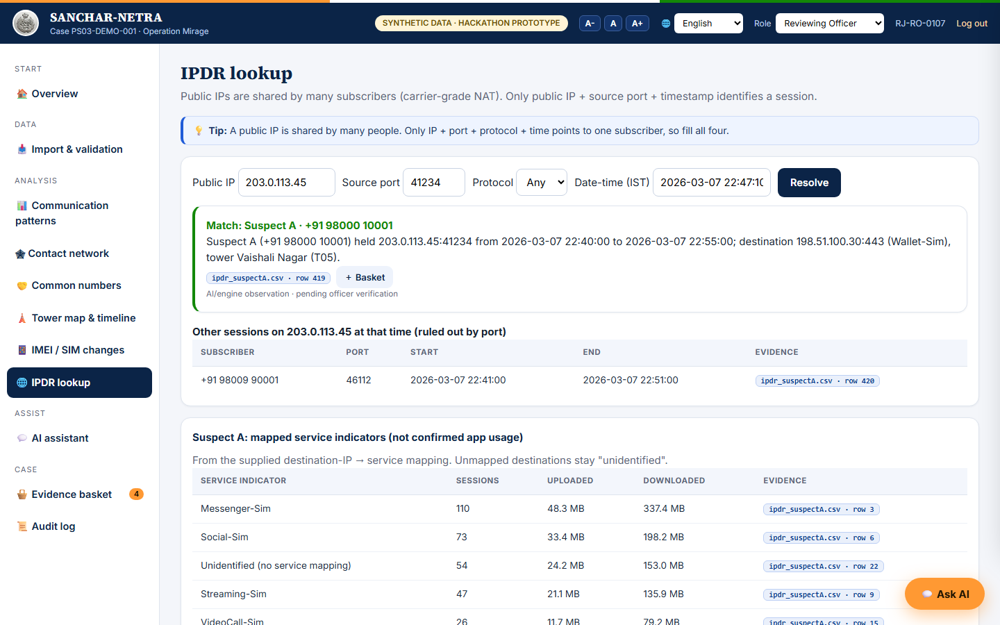
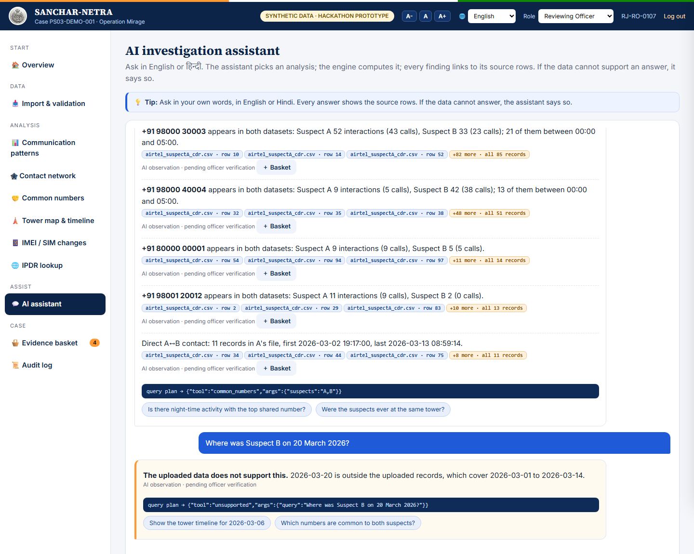
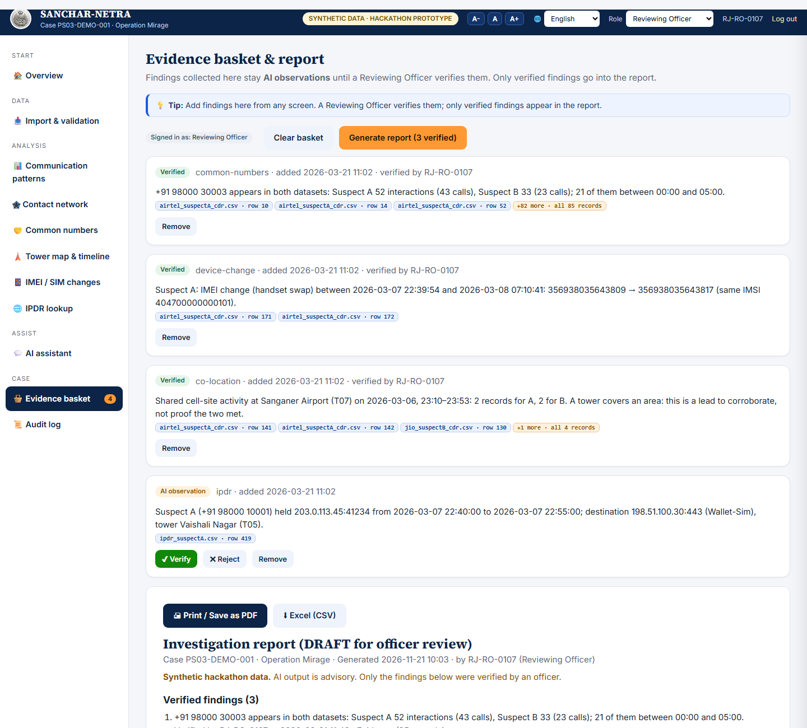
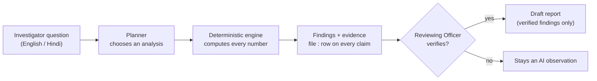

<div align="center">

# SANCHAR-NETRA &nbsp;·&nbsp; संचार-नेत्र

### Evidence-traceable CDR / IPDR investigation support, with an AI assistant that cites its sources

*AI proposes. Code computes. Officers verify.*


**Team HackCrew** · Chennai Institute of Technology · Cyber Security Hackathon 2026 · Problem statement **PS03**

### 🔗 [Live demo → noufalthecoder.github.io/RajasthanpoliceHackathon](https://noufalthecoder.github.io/RajasthanpoliceHackathon/)



</div>

> **Notice.** This is a hackathon prototype built on **synthetic data only**. It is **not** an official Rajasthan Police website or product, and nothing in it is real telecom evidence. AI output is an *observation for officer review*, never a conclusion.

---

## Why this exists

Telecom records (CDR for calls and SMS, IPDR for internet sessions) are key evidence in cyber and conventional cases, but they arrive in different operator formats, run to thousands of rows, and are still filtered by hand. The hard part is not getting the data: it is turning it into **verified, court-defensible leads quickly**.

SANCHAR-NETRA standardises records from different operators, finds the patterns that matter, shows relationships and movement, and lets an investigator ask questions in plain language. **Every finding links back to the exact source row**, and anything the data cannot support is refused rather than guessed.

Read the research behind it: [`docs/PS03_Problem_Research.pdf`](docs/PS03_Problem_Research.pdf) (2 pages, sourced).

## Screens

| | |
|---|---|
| <br>**Case overview.** Key leads at a guided glance. | <br>**Communication patterns.** Contacts, night activity, unusual numbers. |
| <br>**Contact network.** Shared contacts in red; click for records. | <br>**Tower map & replay** on a real OpenStreetMap, with tower details. |
| <br>**IPDR lookup.** IP + port + protocol + time, with others ruled out. | <br>**AI assistant.** Evidence on every answer; honest refusals. |

<details>
<summary>More: draft report</summary>



</details>

## What it does

| Area | Capability | Status |
|---|---|---|
| **Import** | Operator profile detection (Airtel-style, Jio-style, IPDR), column mapping, number and time normalisation, validation report, duplicate audit trail, LAC + cell-ID tower matching | ✅ built |
| **Patterns** | Top contacts, call counts and duration, in/out ratio, first/last contact, night activity, unusual-contact flags | ✅ built |
| **Network** | Contact graph, common numbers, direct links, drill-down to every contributing record | ✅ built |
| **Location** | Tower sequence and replay on a real map, antenna coverage sectors, tower details, street-address lookup, *shared cell-site activity* detection | ✅ built |
| **Devices** | IMEI (handset) and IMSI (SIM) change detection | ✅ built |
| **IPDR** | CGNAT-aware match on public IP + port + protocol + time; service indicators | ✅ built |
| **Assistant** | English and Hindi questions, evidence chips, query plan, follow-ups, refusals when data is missing | 🟡 rule-based planner (LLM planned) |
| **Review** | Evidence basket, reviewer-only verification, verified-only draft report (print-to-PDF, CSV), SHA-256 file hashes, audit log | 🟡 prototype controls |
| **Languages** | English + Hindi, Bengali, Gujarati, Kannada, Malayalam, Marathi, Odia, Punjabi, Tamil, Telugu (Sarvam AI) | ✅ built |

Full status, including what is **planned** for the 24-hour final, is in [`project.md`](project.md).

## How it works



- **The language model never calculates.** Counts, durations, timelines and matches come from tested code.
- **Every claim is traceable.** Chips such as `airtel_suspectA_cdr.csv · row 412` open the raw row; an aggregate like "52 interactions" links to all 52 records.
- **It says when it cannot answer.** Dates outside the data, call content, subscriber identity: refused, with the reason.
- **Careful language.** Two suspects on one tower is *shared cell-site activity*, a lead to corroborate, never proof they met.

## Quick start

Requires Python 3 (server) and Node 18+ (tests only). No build step.

```bash
python tools/serve.py          # then open http://localhost:8000
```

1. Open the page and sign in with a role (mock authentication). To skip sign-in for a quick look: `http://localhost:8000/console/console.html?demo=1`.
2. Start at **Overview**, then follow the **Next step** buttons.
3. Try the demo questions below in the **AI assistant**.

> Language switching works from the bundled translations with no key. To translate new text on demand, copy `.env.example` to `.env` and add a Sarvam API key. **Never commit a key.**

### Try the demo case: *Operation Mirage*
Two suspects, two operators, Jaipur, 1–14 March 2026 (synthetic). Ask the assistant:

- `Which numbers are common to both suspects?` / `दोनों संदिग्धों के बीच common numbers कौन से हैं?`
- `Any IMEI or SIM changes?`
- `Were the suspects ever at the same tower?`
- `Which subscriber had 203.0.113.45:41234 at 2026-03-07 22:47:10?`
- `Where was Suspect B on 20 March 2026?` ← refused: outside the data
- `What was said in the calls?` ← refused: CDR holds metadata only

## Project structure

```
index.html            landing page + sign-in
console/              investigator console
  engine.js           analytics engine + assistant planner (browser and Node)
  console.js          interface: screens, basket, audit, drawer, map, graph
  lang.js, i18n/      language engine and pre-translated bundles (10 languages)
data/                 synthetic case: Airtel-style and Jio-style CDR, IPDR, towers, answer key
tools/
  serve.py            local server + Sarvam translation proxy
  generate_case.py    deterministic synthetic case generator
  test_engine.js      22 checks of the engine against the answer key
  bench_engine.js     scale benchmark
  build_i18n.py       builds the language bundles
docs/                 problem research (PDF) and screenshots
wireframe/            annotated wireframe deck (PDF)
project.md            full technical documentation
```

## Quality

```bash
node tools/test_engine.js          # 22 checks against data/ground_truth.json
node tools/bench_engine.js 50000   # 100,000 records, synthetic
```

| Step (100,000 records) | Time |
|---|---|
| Import, normalise, validate | ~1.5 s |
| Contacts / common numbers / shared cell-site activity | ~0.1–0.2 s each |

The answer key is generated from the same code that creates the data, so tests cannot drift from the dataset. Timings are from a developer laptop on synthetic data: an order of magnitude, not a guarantee.

## Security and privacy (honest status)

- **Prototype:** role-based sign-in, reviewer-only verification and the audit log run **in the browser** as demonstrations; they are not real security controls.
- **Planned for the final build:** server-side login (hashed passwords, JWT, per-case access), encrypted storage, tamper-evident audit log, and external-LLM calls that send only aggregated, pseudonymised results, never raw files.
- **Integrity:** SHA-256 of every source file is shown and included in reports. This supports evidence preservation; it does **not** replace legal acquisition or certification (for example a Section 63 BSA certificate).

## Roadmap

- **Done:** landing page, 11-screen console, synthetic case with answer key, tests and benchmark, multilingual UI, wireframe deck, research brief.
- **24-hour final:** test the official R4C sample data first; FastAPI + DuckDB backend; Claude tool-calling assistant over the same engine; server-side roles, audit and PDF/Excel reports; column-mapping editor.
- **Beyond:** pilot with investigators, local-model option, case linking (with legal and privacy review).

## Documentation

| | |
|---|---|
| [`project.md`](project.md) | Complete technical documentation: requirements, schemas, algorithms, AI design, security, final-build code |
| [`docs/PS03_Problem_Research.pdf`](docs/PS03_Problem_Research.pdf) | Two-page sourced research on the problem |
| [`wireframe/SANCHAR-NETRA_Wireframe.pdf`](wireframe/SANCHAR-NETRA_Wireframe.pdf) | Annotated screens mapped to the problem statement |
| [`data/case_brief.md`](data/case_brief.md) | The demo case and its investigation questions |

## Limitations

All data is synthetic and the operator layouts are our approximation, so the official R4C sample is not yet tested. The assistant is rule-based today. Tower coordinates in the demo are approximate locality positions, not real sites. Machine translation of technical terms is literal. Nothing here is legal advice.

## Credits

Rajasthan Police Service logo: Wikimedia Commons (ViKaZo, CC BY 4.0), shown for hackathon context only; the emblem belongs to its owners. Hawa Mahal photo: jokertrekker (CC BY 3.0). Delhi Police parade photo: Antônio Milena / Agência Brasil (CC BY 3.0). Map data © OpenStreetMap contributors; satellite imagery © Esri. Libraries: Leaflet, vis-network. Translation: Sarvam AI. Built by **Team HackCrew** with AI assistance from Claude.
